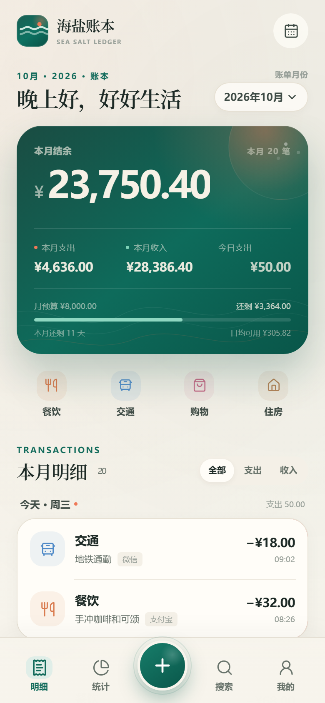
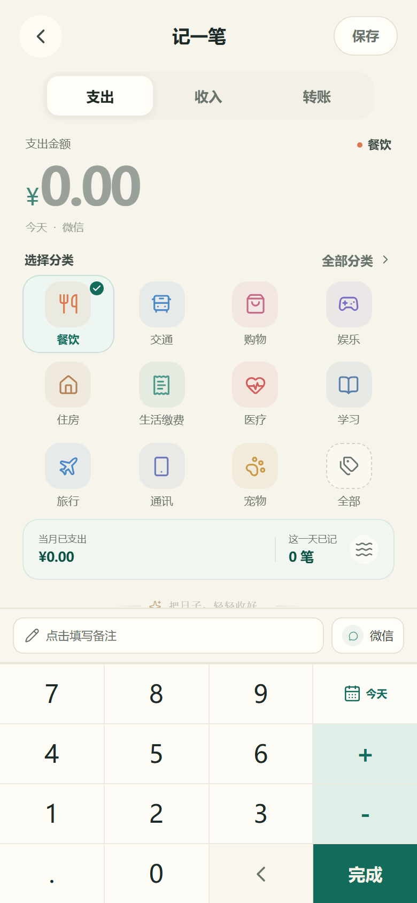
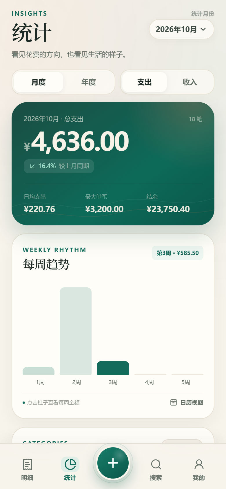
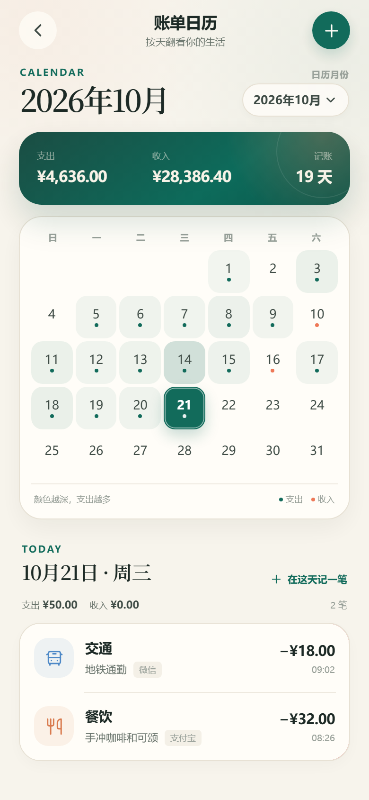
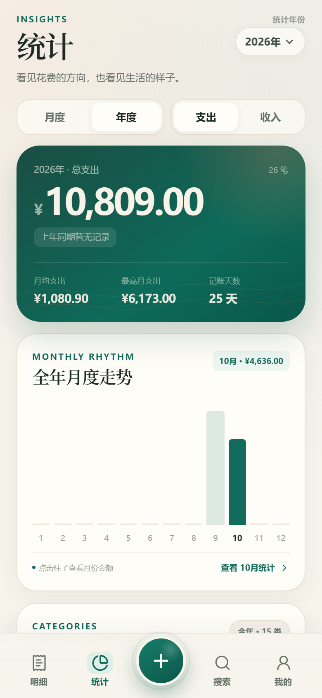
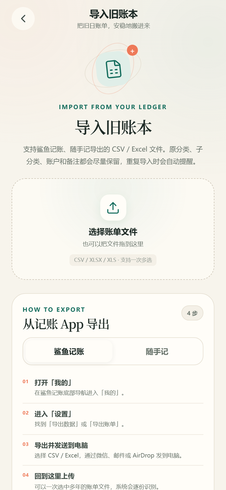
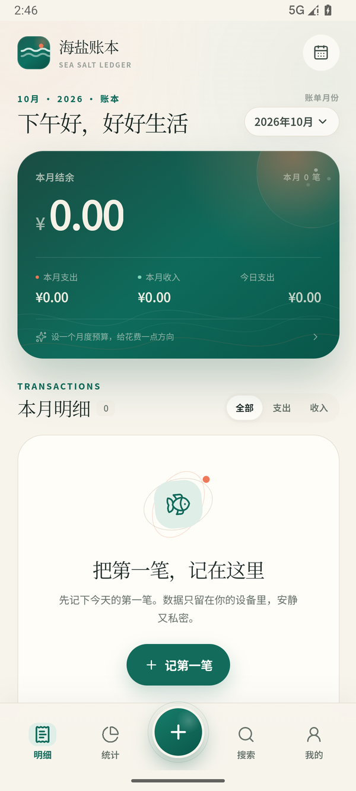
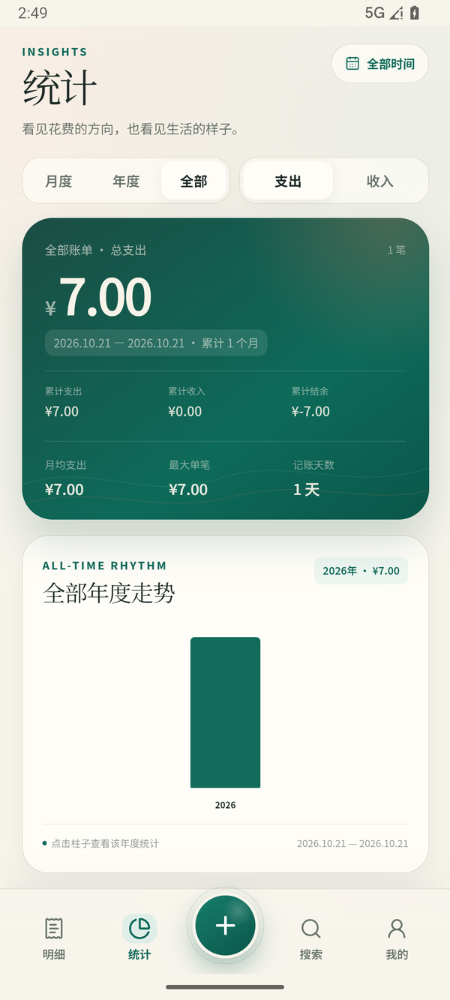

# 海盐账本 · Sea Salt Ledger

[](LICENSE)
[](https://github.com/peterwangze/seasalt-ledger/releases)
[](https://github.com/peterwangze/seasalt-ledger/releases)
[](https://react.dev)

一个为手机操作习惯设计的本地记账 Web App。界面轻盈、克制，所有账单只保存在当前浏览器里，不需要注册，也不会上传云端。

支持一键导入 **鲨鱼记账** 导出的 CSV / Excel 账单，并能保留原分类、账户、备注和重复记录。

当前版本 **1.2.0**：在大账本性能、金额计算器、全部账单统计和随手记导入上完成一轮针对长期使用的优化；导入入口仍收在「我的」。

> 开源仓库：**[github.com/peterwangze/seasalt-ledger](https://github.com/peterwangze/seasalt-ledger)**  
> Android APK 在 [Releases](https://github.com/peterwangze/seasalt-ledger/releases) 发布。



<p align="center">
  
  
  
</p>
<p align="center">
  
  
</p>

## 功能

- **手机优先**：自定义数字键盘、底部导航、Bottom Sheet、iOS 安全区适配、软键盘避让、PWA 可安装到桌面。
- **记账**：支出 / 收入 / 转账；分类、账户、日期、时间、备注；编辑与左滑删除。
- **金额计算器**：金额键盘支持 `+ − × ÷`，带运算优先级和实时结果，适合「28 + 19」这类现场心算。
- **快捷记账**：首页只放高频分类，轻点即带分类进入记账页。
- **明细**：按月查看、按日分组，收支筛选，月度预算进度与日均可用额度；大账本按 10 天分批加载，避免六年账单一次渲染卡顿。
- **统计**：月度 / 年度 / 全部三模式；分类占比、每周趋势、年度 12 个月走势、全部年度走势、分类排行、同比与累计小结。
- **账单日历**：按月查看每日收支、颜色热度和单日明细；可从任意一天直接补记并返回该天。
- **搜索**：按备注、分类、账户、金额搜索全部历史账单，支持时间范围与类型筛选。
- **分类 / 账户管理**：新增自定义分类与账户、设置默认账户。
- **账单导入（我的 → 导入账单）**：
  - 支持**鲨鱼记账**和**随手记**导出的账单；
  - 支持 CSV（UTF-8 / GBK / UTF-16）与 XLSX / XLS；
  - 支持一次选择多个文件（例如多个年度账单）；
  - 自动识别日期、收支类型、金额、分类 / 子分类、账户、备注等列；
  - 随手记的 `收支`、`子分类 / 二级分类`、`成员`、`项目` 等列可直接识别；
  - 单文件可手动调整字段映射；
  - 识别支出 / 收入分列、Excel 日期、中文日期、货币符号和千分位；
  - 保留源分类，自动创建账本里没有的分类；
  - 重复导入智能提醒并默认跳过；
  - 同一文件里真实存在的重复消费不会被误删。
- **数据出口**：导出 CSV、导出完整 JSON 备份、从备份恢复；清空账本。
- **隐私**：无后端、无账号、无外部请求，文件解析完全在浏览器内完成。
- **大账本性能**：月/年/日索引缓存、明细分批加载和离屏日期组延迟渲染；六年、一万三千条账单下切换「明细」不再产生长任务。
- **面向原生封装**：相对资源路径、无服务端依赖、统一安全区与键盘处理，适合 Android / iOS / HarmonyOS WebView 包。

> 本轮的产品调研、功能取舍和后续路线见 [docs/research.md](docs/research.md)。  
> WebView / Capacitor / ArkWeb 的封装注意事项见 [docs/native-packaging.md](docs/native-packaging.md)。

## 快速开始

要求 Node.js 20 以上。

```bash
npm install
npm run dev
```

打开 `http://127.0.0.1:5173/`。推荐在浏览器开发者工具中切换到手机尺寸（390 × 844）体验。

### 在手机上打开

开发模式默认只监听本机。若手机与电脑在同一局域网，可以运行：

```bash
npm run dev -- --host 0.0.0.0
```

然后使用电脑的局域网 IP 访问（例如 `http://192.168.1.20:5173/`）。

> 这里的“局域网访问”只是访问前端页面；账单数据仍保存在各自浏览器中，不会同步到服务器。

## Android APK

当前提供可直接安装的签名 release APK：

**[从 GitHub Releases 下载 SeaSaltLedger-1.2.0.apk](https://github.com/peterwangze/seasalt-ledger/releases/latest)**

| 项目 | 值 |
| --- | --- |
| 包名 | `com.seasalt.ledger` |
| 版本 | 1.2.0（versionCode 2） |
| 支持系统 | Android 8.0 / API 24 及以上 |
| 目标 SDK | 36 |
| APK 大小 | 6,952,657 bytes（约 6.6 MB） |
| SHA-256 | `6945D442A0275C2A395731DD4B4213874202B8504CC9502B74B889ED02864769` |
| 签名 | v2 APK Signature Scheme，证书 DN `CN=Sea Salt Ledger` |

安装方式：

```bash
adb install -r SeaSaltLedger-1.2.0.apk
```

或在手机上打开 APK，允许“安装未知应用”。这是侧载发布包；上架 Google Play 还需要开发者账号并上传 AAB。

构建、签名、版本升级和原生桥接说明见 **[android/README.md](android/README.md)**。

<p align="center">
  
  
</p>

已在本机 Android 16（API 36）模拟器验证：APK 安装与冷/热启动、首页 / 统计导航、金额计算器、全部统计、随手记文件选择、原生返回键关闭月份 Sheet，以及 CSV 导出调用系统分享面板。

**签名密钥很重要**：`android/keystore/seasalt-release.jks` 和 `android/keystore.properties` 已被 `.gitignore` 忽略，请立即另存备份；后续更新必须使用同一密钥。

### 构建与预览

```bash
npm run build
npm run preview
```

构建文件在 `dist/`，可以部署到任意静态站点。使用 HTTPS（或 localhost）访问时，浏览器会注册 Service Worker，支持离线打开和“添加到主屏幕”。

### 测试

```bash
npm run test        # 单元测试
npm run typecheck   # TypeScript 检查
```

UI 冒烟测试需要先启动开发服务器，再运行：

```bash
npm run test:e2e
```

默认使用本机安装的 Chrome（通过 `CHROME_PATH` 可指定其他路径）。测试使用独立浏览器上下文，不会影响你平时浏览器里的账本。

## 导入鲨鱼记账 / 随手记

通用步骤：

1. 在源 App 中导出 CSV 或 Excel，并发送到电脑。
2. 在本应用进入 **我的 → 导入账单**，一次选中一个或多个文件。
3. 检查识别结果，必要时点「调整字段」。
4. 点击「导入 N 笔」。

### 鲨鱼记账

进入 **我的 → 设置 → 导出数据 / 导出账单**，选择 CSV / Excel。

### 随手记

进入 **我的 → 设置 / 高级功能 → 备份与同步 → 导出数据 Excel**。常见列包括 `日期 / 收支 / 分类 / 子分类 / 金额 / 备注 / 账户 / 成员 / 项目`；应用会优先使用「子分类」，并保留账户和备注。

识别时会把「日期 / 收支类型 / 类别 / 子分类 / 账户 / 金额 / 备注」这些列自动匹配。如果有重复导入风险，页面会提示并默认跳过重复项；也可以关闭开关保留所有记录。

**关于重复消费**：源 App 可能同一天有多次同金额消费。应用以“文件批次 + 行内出现次序”识别重复，首次导入会完整保留这些记录，不会简单按金额去重。

## 数据与备份

- 数据保存在浏览器 **IndexedDB**（不可用时退回 localStorage）；不会上传。
- 清除浏览器站点数据、换浏览器或卸载 PWA 可能导致数据丢失。
- 建议定期在 **我的 → 备份整个账本** 导出 JSON，再用「从备份恢复」还原。
- CSV 导出便于在 Excel / Numbers 中查看，不作为完整恢复格式。

## 技术栈

- React 19 + TypeScript + Vite
- Capacitor 8（Android WebView 容器、SystemBars、Filesystem、Share、App）
- Lucide 图标
- SheetJS（仅 Excel 解析，按需加载）
- 原生 CSS 设计系统，无 UI 框架
- IndexedDB + 自定义持久化层
- Vitest 单元测试 + Playwright 移动端冒烟测试（`e2e/smoke.mjs`）

## 目录

```text
src/
  components/       通用 UI：图标、底部导航、Sheet、账目行等
  data/             默认分类 / 账户 / 图标与颜色规则
  lib/
    import/         文件解码、CSV 解析、字段识别、账单归一化
    calendar.ts     月历网格、每日聚合与热度
    date.ts         本地日期、月份与年度工具
    stats.ts        收支、周/月/年趋势、分类与对比计算
    storage.ts      IndexedDB / localStorage 持久化
    export.ts       CSV / JSON 导出
  pages/            明细、记账、月度/年度统计、日历、搜索、导入、设置、分类、账户
  store/            账本状态、会话月份与 Hash 路由
android/            Capacitor Android 工程、图标、签名与构建说明
assets/             App 图标 / 启动图源文件
releases/           构建信息（APK 通过 GitHub Releases 分发）
docs/
  research.md       市场功能调研与本轮取舍
  native-packaging.md 原生封装指南
  release-notes-v1.2.0.md
```

## 已知边界

- 导入时的转账记录会被跳过（需要手动补记），因为导出文件通常缺少完整的转出 / 转入账户。
- 多文件导入使用自动字段识别；如有格式差异，请单独导入并手动调整字段。
- 没有云同步、多人共享或账号登录，这是刻意的本地优先设计。
- PWA 离线缓存需要 HTTPS 或 localhost；原生 WebView 包不依赖 Service Worker。
- 周期账单、分类预算、账户资产余额等市场常见能力列在 [docs/research.md](docs/research.md) 的下一阶段路线中。

## 参与贡献

欢迎 Issue 和 Pull Request。开始前请阅读 [CONTRIBUTING.md](CONTRIBUTING.md)，尤其是「不要提交真实账本数据」这一节。

版本变化见 [CHANGELOG.md](CHANGELOG.md)。

## 开源协议

本项目使用 [MIT License](LICENSE)。你可以自由使用、修改和分发，但需保留版权与许可声明。

如果这个项目对你有帮助，欢迎点一个 Star。

---

把每一笔，过成生活。
